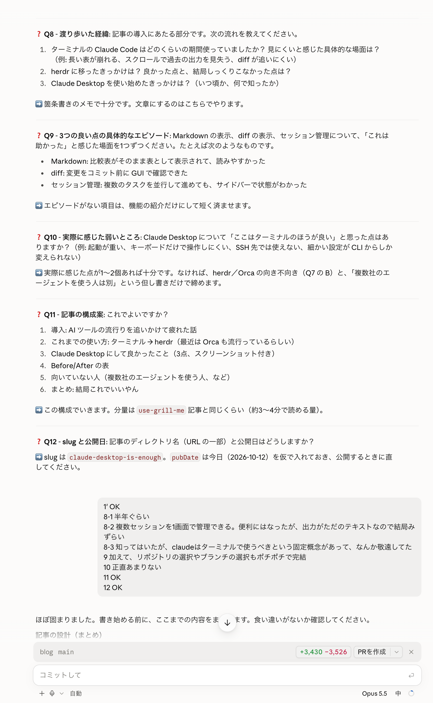
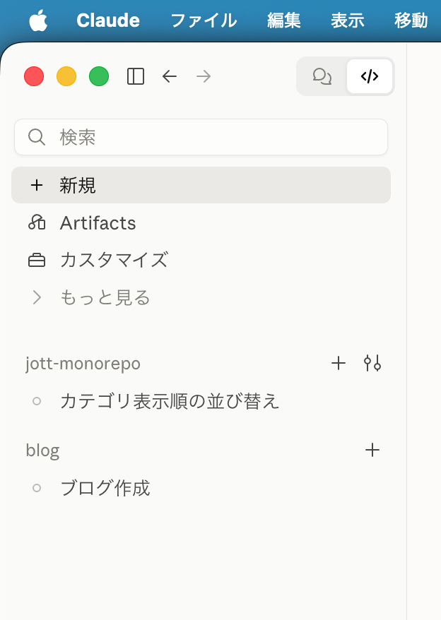

AIツールの流行りって本当に早い...

新しいツールが出るたびにXでバズって、入れてみて、設定して、慣れてきた頃にはまた次のツールが話題になっている...

つらい...

なお、ここでいう「Claude Desktop」は、Claudeのデスクトップアプリの**Codeタブ**のことです。

使用感はClaude Codeをターミナルで使うのとほぼ同じ。

## これまでの使い方

### ターミナルで使っていた時期

最初の半年ぐらいは、普通にターミナルでClaude Codeを使っていました。

特に不満なく使えてはいたものの、出力がテキストなので、長い説明や表、差分などはどうしても見づらく感じていました。

### herdrに乗っかってみた

その後、流行りに乗っかって[herdr](https://herdr.dev)を使ってみました。

複数のセッションを1画面で管理でき、各エージェントが作業中なのか入力待ちなのかもサイドバーで分かるので、並行して作業を進めるにはかなり便利になりました。

が...

出力は結局ただのテキストのままなので、見づらさは変わらず...

最近だと[Orca](https://onorca.dev)も流行っているらしいですね。（自分は触っていないです）

## 食わず嫌いだったClaude Desktop

Claude Desktopの存在自体は前から知っていましたが、自分の中で「Claude Codeはターミナルで使うもの」という固定観念があって、敬遠していました。

そんなとき、なんとなく使ってみたら、「あ、これでいいやん」となりました。

## Claude Desktopにして良かったこと

### 出力がMarkdownで表示される

一番大きいのはこれ。

見出し、表、コードブロックなどがちゃんとレンダリングされて表示されるので、長めの説明でも読みやすいです。

### セッションの管理がしやすい

herdrで便利だと感じていた「複数セッションの管理」も、サイドバーで一覧できます。

セッションの切り替えも、複数セッションを並べての分割表示もできるので、herdrでやっていたことはほぼこれで完結します。

### リポジトリやブランチの選択がポチポチで完結

作業するリポジトリやブランチもGUIで選択できます。

`cd`してブランチを切って...という作業がポチポチで終わるのは地味に快適。

## 向いていない人？

正直、Claude Desktop自体に大きな不満はあまりないです。

ただ、Claude Code以外にもCodexやCursorなど、**複数社のAIエージェントを使い分けている人**は話が別だと思います。

Claude DesktopはあくまでClaude専用なので、そういった人はherdrやOrcaのような、複数のエージェントに対応したツールを使う方が合っているかもしれません。

## まとめ

AIツールの流行り廃りを追いかけ続けるのは正直疲れます。

Claudeしか使わないのであれば、公式のClaude Desktopで十分というのが今の自分の結論です。
